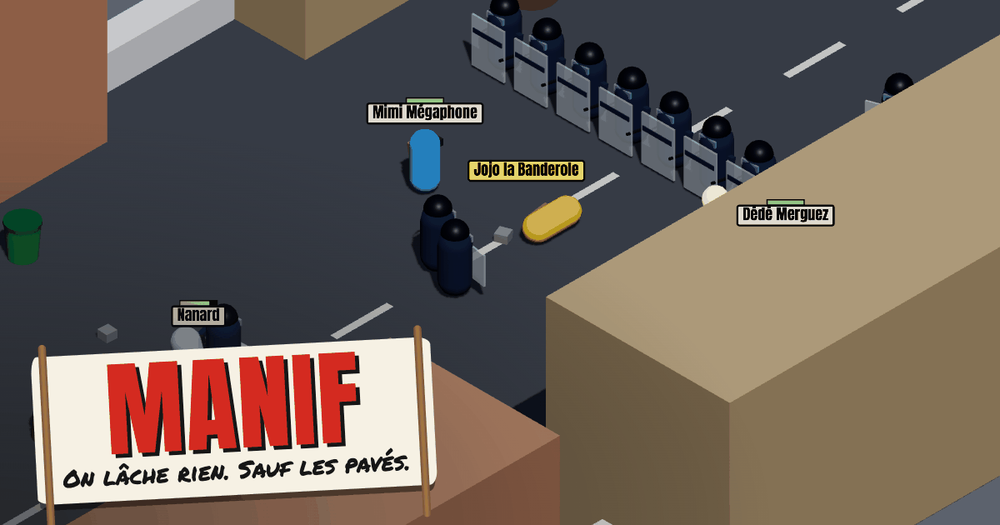

# manif

**A goofy multiplayer game about the French street protest.** You and up to
seven friends march down a long street to the Préfecture while the CRS try to
baton you, grab you and drag you off to the van. It runs in the browser, on a
computer or a phone, with no install and no account: one person makes a
lobby, drops the link in the group chat, and everyone is in.

It's satire, not a side. Protesters, police, pompiers and the bus shelters are
all part of the joke, and nobody bleeds: falls are floppy and arrests are
slapstick. The game itself is in French.

**[Play it at manif.bazlab.si](https://manif.bazlab.si)**



## How a round goes

- **March.** The host starts the round and you have 8 minutes to get at least
  half the cortège, free, into the Préfecture forecourt at the far end of the
  street. Run out of time, or get everyone arrested at once, and you lose.
- **The police.** CRS chase and grab protesters, form shield lines across the
  street and lob tear gas. Further down, a plain-clothes BAC slips into the
  cortège looking like one of you, and BRAV-M motorbike duos charge in.
- **Fight back, or help out.** Smash bins, bus shelters and shops (big
  storefronts in the facades, laid out afresh every round with a new mix of
  boulangeries, cafés, banks and more),
  throw the pavés (and tomatoes, dog poo, trottinettes, even a teammate),
  dodge, hop over things, and pull a grabbed friend free before the van.
- **Fire and pompiers.** Set a bin or a car alight. The fire spreads, anyone
  who walks through it gets their bum set on fire, and a fire truck turns up
  to hose it all down, protesters and CRS alike.
- **Pick who you are.** In the lobby, choose an archetype (bobo gaucho, gilet
  jaune, black bloc, syndicaliste CGT, retraité·e...) with its own strengths.
  Empty seats fill with bot protesters, up to 8.
- **Score.** Useful actions earn points, arrests cost some, and your total
  carries over to a lasting leaderboard in the lobby.

Controls: ZQSD / WASD or arrows to walk, click to hit or throw, Space to hop,
Shift to dodge, E to pick up, rescue or light (hold), Tab for the scoreboard,
C for the help. Phones get a joystick and buttons.

Every mechanic in detail: [docs/gameplay.md](docs/gameplay.md).

## Quick start

You need [bun](https://bun.sh) 1.4.2 (pinned in `package.json`) and Node 24
(the server runs on Node; bun is only the package manager).

```sh
bun install
bun run dev
```

That starts the shared package in watch mode, the game server on
`ws://localhost:2567` and the client on http://localhost:5173. Open it, create
a lobby, then open the invite link (`/?lobby=<code>`) in a second browser or a
private window (tabs of one browser share the saved name). The others ready
up and the host presses Start. You can also start alone: bots fill the
cortège (the "Compléter avec des bots" switch in the lobby).

Before pushing, run the full check. The build is the bar: typecheck and lint
can pass while the build fails.

```sh
bun run build && bun run typecheck && bun run lint && bun run test
```

### Commands

| Command | Does |
| --- | --- |
| `bun run dev` | Shared (tsc watch), server (tsx watch, :2567) and client (Vite, :5173) |
| `bun run build` | Builds all three; the client build also typechecks |
| `bun run typecheck` | `tsc --noEmit` everywhere |
| `bun run lint` | oxlint |
| `bun run test` | Unit tests (`bun test`), which sit next to the code as `*.test.ts`. The client's tests build it first |
| `bun run --cwd apps/server start` | Runs the built server (`node dist/app/index.js`) |
| `bun run og:render` (in `apps/client`) | Redraws the link preview image; see [docs/link-previews.md](docs/link-previews.md) |
| `bun run --cwd apps/client portraits` | Redraws the archetype portraits of the lobby's role picker from the game's models (needs Google Chrome) |

All root commands go through turbo (`turbo.json`).

## Layout

```
apps/
  client/            Vite + React + three.js (@react-three/fiber), Colyseus SDK
    src/app/         bootstrap: main.tsx, App.tsx, styles.css
    src/features/    one folder per feature: lobby, player, crs, fire, round, score, audio...
    src/shared/      net/ (connection, invite link, device token), iso/ (camera maths)
    seo/             link preview and search tags, and the Vite plugin that writes them
    public/          og/og.png, icons, sounds/ (CC0, with CREDITS.md)
    Caddyfile        the production web server
  server/            Colyseus 0.18 game server, runs on Node
    src/app/         bootstrap: the server, /health and /leaderboard
    src/features/    server side of each feature (Schemas, timers, the SQLite score store...)
    src/rooms/       StreetRoom and its root state, which wire the features together
packages/
  shared/src/        rules both sides use: constants, message names, payload types, level
                     data, collision, and the pure logic of each feature (no runtime deps)
docs/                design notes that are too long for this page
```

A feature has the same name on the client, the server and in shared (`crs`,
`fire`, `round`...), and each folder has an `index.ts`. Features import each
other only through that `index.ts`, `shared/` never imports from `features/`,
and tests sit next to the code they test. The rules are in
[AGENTS.md](AGENTS.md#code-layout); how the pieces talk to each other is in
[docs/architecture.md](docs/architecture.md).

The server is authoritative: clients send inputs, the server moves everyone
and syncs the result. The level is static data in `@manif/shared`, so it is
never synced.

## Where to change things

The most common ones. The [full table](docs/where-to-change-things.md) has a
row for nearly every number and rule in the game.

| To change... | Look in |
| --- | --- |
| Almost any number (speeds, HP, cooldowns, ranges) | `packages/shared/src/<feature>/constants.ts` |
| The street: walls, props, spawn points, the Préfecture | `packages/shared/src/level/street.ts` |
| Police units (CRS, BAC, BRAV-M, pompiers): stats | `CRS_STATS` in `packages/shared/src/crs/constants.ts` |
| What the police bots decide | `packages/shared/src/crs/brain.ts`, `bac.ts`, `bravm.ts`, `line.ts`, `lbd.ts` (the CRS LBD and its ball) |
| Round length, win rule, reinforcement waves | `packages/shared/src/round/constants.ts` |
| Archetypes | `ARCHETYPES` in `packages/shared/src/archetype/constants.ts`; looks in `apps/client/src/features/archetype/archetypeVisuals.tsx` |
| The archetype portraits in the lobby (`apps/client/public/portraits/`) | Which body and colours: `apps/client/src/features/player/portrait.ts`; framing: `apps/client/src/app/portraits/Studio.tsx`. Then redraw them with `bun run --cwd apps/client portraits`, look at them, and commit them. Redraw them too after a body model or a wardrobe colour changes |
| Shop kinds, signs, dealing rules and layout (sizes, clearances) | `PROP_TYPES` in `packages/shared/src/prop/constants.ts`, `SHOP_TYPES` and `SHOP_LAYOUT` in `prop/shops.ts`; looks in `apps/client/src/features/prop/shopVisuals.tsx` (a new kind also needs its room dressing in `features/level/roomInterior.ts`, its name in `features/help/content.ts` and its sounds in `features/audio/cues.ts`; append it to `SHOP_KINDS`, never reorder) |
| Throwables (pavé, tomate, crotte, trottinette) | `THROWABLE_TYPES` in `packages/shared/src/throwable/constants.ts` |
| Points per action and per-round caps | `ACTION_POINTS` in `packages/shared/src/score/constants.ts` |
| Bot protesters | `BOT` in `packages/shared/src/bot/constants.ts`, `bot/brain.ts` |
| Sounds | `apps/client/src/features/audio/` (`cues.ts`, `sounds.ts`); files in `apps/client/public/sounds/` |
| A placeholder 3D look | the feature's `*Visuals.tsx` in `apps/client/src/features/` |
| A new client → server message | `packages/shared/src/net/messages.ts`, handled in `apps/server/src/rooms/StreetRoom.ts` |
| New synced state | a Schema in the server feature, added to `apps/server/src/rooms/state.ts`, plus the plain type in `packages/shared/src/net/state.ts` |
| Something to reset between rounds | `StreetRoom.resetStreet()` |
| Homepage and lobby screen | `apps/client/src/features/home/`, `features/lobby/` |
| Link preview text and image | `apps/client/seo/meta.ts`, `apps/client/public/og/og.png` |

## Config

Nothing is needed for local dev. In production the compose file sets
everything.

| Variable | Where | What |
| --- | --- | --- |
| `VITE_SERVER_URL` | client, build time | Game server address. Unset: `ws://<page host>:2567`. A path such as `/colyseus` means the page's own origin (production). See `apps/client/.env.example` |
| `VITE_SENTRY_DSN` | client, build time | Error tracking (self-hosted Rustrak). Unset turns it off |
| `PORT` | server | Listening port, default `2567` |
| `NODE_ENV` | server | `development` (set by `bun run dev`) is the only value that accepts the debug messages; unset or anything else refuses them. A built server run by hand for scripted checks needs `NODE_ENV=development` |
| `SENTRY_DSN` | server | Error tracking. Unset turns it off |
| `SCORE_DB_PATH` | server | SQLite file for the lasting scores. Unset (the dev default): round scores only. A missing folder is created; an unreadable file is logged and the game carries on without it |
| `MANIF_MAX_ROOMS` | server | Most lobbies alive at once on the server, default `100`. Past it, creating a lobby is refused until one ends. Each visitor also has a small creation budget (`apps/server/src/features/lobby/`) |
| `MANIF_DIAG` | server | `1` logs tick time during a march and anything still keyed by a bot that left |
| `CLIENT_PORT` | local compose only | Port for `docker-compose.local.yaml`, default `8080` |

The Sentry DSNs are public ingest keys, committed as defaults in
`docker-compose.yaml`.

turbo runs tasks in strict env mode, so a variable set in your shell does not
reach `bun run dev` on its own. To try the leaderboard locally, pass
`--env-mode=loose`:

```sh
SCORE_DB_PATH=/tmp/manif.db bun run dev --env-mode=loose
```

The server answers `GET /health` (200 while up) and `GET /leaderboard` (top
names and totals, never a token).

## Deploy

Production runs [`docker-compose.yaml`](docker-compose.yaml) on Coolify at
https://manif.bazlab.si. Two containers:

- **`client`**: the Vite build served by Caddy on port 80, the only public
  service. It proxies `/colyseus/*` (matchmaking and WebSockets) to the
  server, serves `invite.html` for invite links and `index.html` for any other
  page. See `apps/client/Caddyfile`.
- **`server`**: the Colyseus server on Node 24 (distroless, non-root),
  reachable only from the client. It sets `SCORE_DB_PATH=/data/manif.db` and
  mounts the **`scores` named volume** at `/data`.

On Coolify: a Docker Compose resource from this repo, the domain on the
`client` service, port 80 (Coolify's proxy adds TLS), and no domain on
`server`. There is nothing to set in Coolify's environment page; the defaults
are in the compose file and listed in `.env.production.example`.

**What a redeploy keeps and loses.** Lobbies live in the server's memory, so a
redeploy ends every game in progress (the server closes its rooms on SIGTERM).
The lasting scores are kept: Coolify keeps named volumes across redeploys.
Deleting the `scores` volume resets every total to 0. To back it up, copy
`manif.db` out of the volume while the server is stopped. If the file can't be
opened, the server logs `[score] cannot open ...` and runs with round scores
only.

To run the production setup locally, on http://localhost:8080:

```sh
docker compose --env-file .env.production.example \
  -f docker-compose.yaml -f docker-compose.local.yaml up --build
```

Two things that bite:

- **Keep `linker = "hoisted"` in `bunfig.toml`.** With bun's isolated linker
  there are two copies of `@colyseus/core`, and every join fails with "seat
  reservation expired".
- **A new workspace package** needs its `package.json` copied in the manifest
  step of both Dockerfiles, and a new server runtime dependency must be a
  `dependency`, not a `devDependency`.

### Cloudflare in front

The domain goes through Cloudflare, then Coolify's proxy, then Caddy. Caddy's
headers decide what is cached; Cloudflare is set to follow them (#90):

| Path | Browser | Cloudflare |
|---|---|---|
| `/assets/*` (hashed bundles) | 1 year, `immutable` | 1 year |
| `/sounds/*`, `/models/*`, `/og/*`, `favicon.svg`, `apple-touch-icon.png` | 1 minute | 1 day, purged on each deploy |
| Pages (`/`, `/aide`, `/?lobby=…`), `robots.txt`, `sitemap.xml` | revalidates (`no-cache`) | not cached |
| `/colyseus/*` (matchmaking, WebSockets, health) | `no-store` | bypassed |
| `/colyseus/leaderboard` | revalidates | 15 s, only with the optional rule below |
| A 404 or any other error | `no-store` | not cached |

Cloudflare's longer edge time for unhashed files comes from a separate
`Cloudflare-CDN-Cache-Control` header that Cloudflare reads and strips. It
carries `stale-while-revalidate`, which `s-maxage` would turn off.

To rebuild the Cloudflare side, in the zone's dashboard:

- **Caching → Configuration → Browser Cache TTL: "Respect existing
  headers".** Otherwise Cloudflare raises `no-cache` and short `max-age`s to
  4 hours, and browsers keep an old sound after a deploy.
- **Caching → Cache Rules**, in this order (a later rule wins over an earlier
  one):
  1. *Bypass the game server*: URI path starts with `/colyseus/` → **Bypass
     cache**.
  2. *(Optional) Leaderboard*: URI path equals `/colyseus/leaderboard` →
     **Eligible for cache**, Edge TTL "Use cache-control header if present,
     bypass cache if not", Browser TTL "Respect origin". It absorbs refresh
     spam for 15 s.
  3. *Static files*: URI path starts with `/assets/`, `/sounds/`, `/models/`
     or `/og/`, or equals `/favicon.svg` or `/apple-touch-icon.png` →
     **Eligible for cache**, Edge TTL "Use cache-control header if present,
     bypass cache if not", Browser TTL "Respect origin". Needed for the models:
     Cloudflare does not cache `.glb` files by default.
- **Network → WebSockets: on.** The rooms run over WebSockets.
- **Speed: Rocket Loader, Email Obfuscation and Mirage off.** They inject
  scripts that the CSP (`script-src 'self'`) blocks, which breaks the page
  without an error. Check that the page's HTML only loads our own scripts.

None of this touches `CF-Connecting-IP`/`X-Forwarded-For`, which the
lobby-creation limit reads.

**The purge after each deploy.** A deploy can change a sound or a model under
the same name, and Cloudflare would keep its copy for a day.
[`scripts/cf-purge.sh`](scripts/cf-purge.sh) empties Cloudflare's copies of
`/sounds`, `/models`, `/og` and the icons (purge by prefix, available on every
plan). It leaves `/assets` alone, so a tab opened before the deploy still gets
its old chunks. The client image has it as `cf-purge`. To set it up:

1. In Cloudflare, *My Profile → API Tokens → Create Token*, custom token,
   permission **Zone → Cache Purge → Purge**, zone resources **only this
   zone**. Nothing else: the token sits in the client container's environment.
2. In Coolify, on the resource's *Environment Variables* page, add `CF_ZONE_ID`
   (the zone's id, on its *Overview* page) and `CF_API_TOKEN`, both marked as
   secrets (locked). Never commit them; the compose file only passes them
   through to the `client` service.
3. In Coolify, on the resource's *General* page, under *Pre/Post Deployment
   Commands*: post-deployment command `cf-purge`, container name `client` (the
   Compose service name). Coolify runs it with `sh -c` inside the new
   container once the deploy is up. If that field is missing for this
   resource, run the purge by hand after a deploy (below).

A run prints one line to the deploy log. With either variable empty it only
says so and exits 0, so the deploy never fails because of it. A refused purge
exits 1 and prints Cloudflare's reason (never the token). To run it by hand
from a checkout:

```sh
CF_ZONE_ID=<zone id> CF_API_TOKEN=<token> sh scripts/cf-purge.sh
```

**The ~1 minute of 503s during a deploy.** Coolify's rolling updates (the old
container serves until the new one is healthy) only exist for single-image
resources, not for Docker Compose ones: Compose stops and recreates the
containers itself. Both services have a healthcheck, so the `client` waits for
a healthy `server` and a broken build shows up as an unhealthy deploy, but
there is no toggle that removes the gap with this setup. The only way out is
to split the `client` into its own Coolify application (Dockerfile type, no
host port, on the server's network) with rolling updates on. Even then, a
redeploy of the `server` ends every game in progress, since lobbies live in
its memory.

## For contributors and AI agents

- [AGENTS.md](AGENTS.md): git workflow (no direct pushes to `main`, squash
  merged PRs), the code layout rules.
- [PRODUCT.md](PRODUCT.md): who the game is for, its tone and what it won't do.
- `.agents/skills/` (linked into `.claude/skills/`, pinned in
  `skills-lock.json`): skills for Colyseus 0.18 and three.js. Colyseus 0.18's
  API is very different from older versions, so trust the skill over memory.
- [docs/](docs/): [gameplay](docs/gameplay.md),
  [architecture](docs/architecture.md),
  [the full "where to change things"](docs/where-to-change-things.md),
  [link previews and search](docs/link-previews.md).

## Credits

- **Sounds**: all CC0, sources listed in
  [apps/client/public/sounds/CREDITS.md](apps/client/public/sounds/CREDITS.md).
  A few are made in code (`apps/client/src/features/audio/synth.ts`).
- **3D art**: by Jordan. Every model in the game today is a placeholder made of
  simple shapes until the real ones land (#28).
